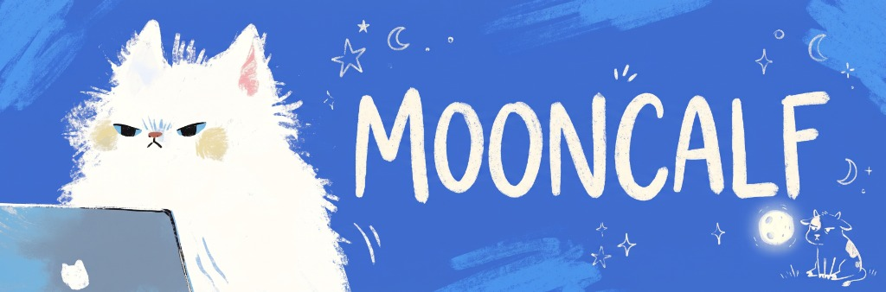

 

 

&nbsp;

---

### 🌙 About me

I'm a **fullstack developer** who spends late nights somewhere between blockchains and neural networks.
I explore **crypto** and **AI**, build weird and interesting things, and keep trying to find the patterns hidden in these lines of code.

- 🔮 Researching AI & crypto — and the strange places where they meet
- 🧩 Hunting for patterns in code, charts and chaos
- 🛠️ Building everything from backend services to pixel-perfect interfaces
- 🚀 Currently cooking something new — stay tuned
- 💬 Ask me about **Go**, **TypeScript**, **Web3** and **LLMs**
- ⚡ Fun fact: my best ideas show up at 3 AM

---

### 🛠️ Tech stack

---

### 📈 Market watch

&nbsp;&nbsp;

Live prices via CoinGecko · not financial advice, just vibes 🌕

---

### 📊 GitHub stats

  
  
   
  

---

### 🚧 Projects

> The moon is still loading… new projects are on the way. ✨

---

 

☾ Made with curiosity, coffee and a little bit of moonlight ☾

